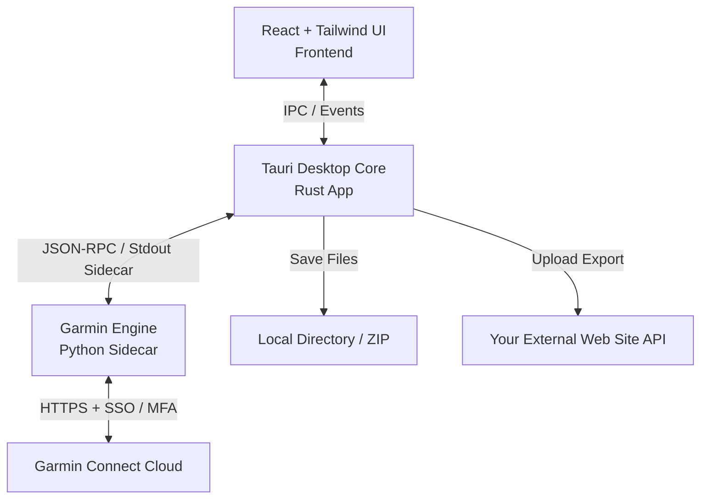
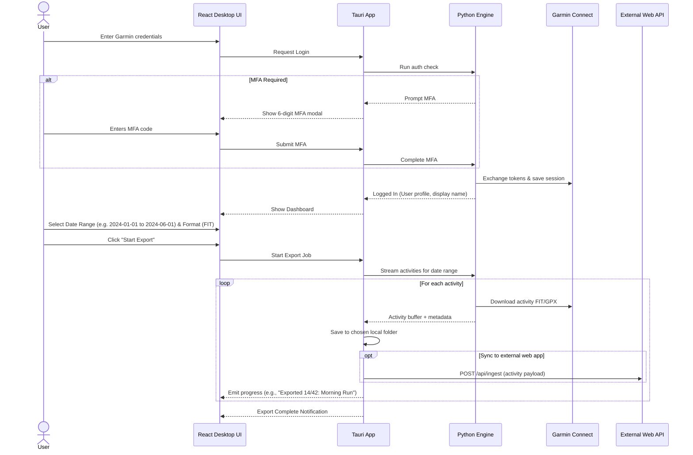

# Implementation Plan: Garmin Ingestor Desktop App

A polished, open-source desktop application that enables users to securely authenticate with Garmin Connect, query activities within a customized date range, and bulk export `.fit` / `.gpx` files either to their local file system or directly to a target web API.

---

## 1. System Architecture

Garmin's unofficial SSO changes frequently and requires complex cookie and token handling (OAuth1/OAuth2 exchanges, Cloudflare challenges, MFA). The Python ecosystem (`garminconnect` + `garth`) is the gold standard for maintaining compatibility with Garmin's endpoints.

To deliver a **lightweight native desktop experience (Tauri)** while leveraging the **resilience of the Python engine**:

### Key Components
1. **Frontend (React + Vite + Tailwind CSS + Lucide Icons):**
   * **Login View**: Garmin username + password with interactive MFA (SMS/email code) prompt modal. Session persistence so users only log in once.
   * **Export Dashboard**:
     * Date range pickers (Start Date, End Date) with quick presets ("Last 30 Days", "Year to Date", "All Time").
     * Format selection (`FIT` original, `GPX`).
     * Destination options:
       * Local folder selection (via native file dialog).
       * Remote Sync target: Webhook / API URL + API Key header for pushing data directly to your separate web application.
     * Real-time progress bar, activity count, per-file download status, and cancellation support.
   * **Settings View**: Manage cached session credentials, API configurations, and default download preferences.

2. **Tauri Core (Rust):**
   * Native window management, file-dialogs (`tauri-plugin-dialog`), directory creation, file I/O (`tauri-plugin-fs`), and secure keychain/storage for auth tokens.
   * Spawns and manages the Python background sidecar process.
   * Relays streaming progress events from sidecar to UI.
   * Optional HTTP client to upload exported batches directly to your remote site API.

3. **Garmin Engine Sidecar (Python):**
   * Utilizes `garth` and `garminconnect` to handle login, MFA, and session tokens.
   * Session directory saved locally (e.g. `~/.garmin-ingestor/session/`) so credentials are never sent to external servers.
   * Activity query pagination (`get_activities_by_date(start, end)`).
   * Streamed download with rate-limiting backoff (jitter) to prevent Garmin IP bans.

---

## 2. User Experience Flow

---

## 3. Phased Implementation Roadmap

### Phase 1: Core Engine & CLI Prototyping
* Set up isolated Python environment with `garminconnect`, `garth`, `pydantic`.
* Build standalone engine module (`garmin_engine/`):
  * `auth.py`: Login, MFA handler, token caching & validation.
  * `client.py`: Paginated activity fetching within `start_date` and `end_date`.
  * `exporter.py`: Downloading original `.fit` and `.gpx`, writing to disk, progress callbacks.
  * `cli.py`: Standalone CLI executable (useful for headless servers and testing before Tauri packaging).

### Phase 2: Tauri 2.0 & React Vite Setup
* Initialize Tauri 2.x project in `garmin-ingestor`.
* Install Rust toolchain (`rustup`) and build dependencies.
* Build the React frontend with Vite, Tailwind CSS, Lucide icons, and date pickers.
* Wire Tauri plugins (`dialog`, `fs`, `shell`, `store`).

### Phase 3: Sidecar IPC Integration & Remote Sync
* Implement IPC bridge between Tauri Rust commands and Python sidecar via JSON-RPC / CLI protocol.
* Implement destination handler:
  * Local folder export with clean file naming: `{date}_{activity_type}_{activity_id}.fit`.
  * Remote web API sync: Configurable webhook endpoint (`POST https://your-site.com/api/activities/sync`) with Bearer token authentication.
* Real-time progress bar, cancellation token, retry logic.

### Phase 4: Packaging, Polish & Open Source Readiness
* Add CI/CD GitHub Actions workflow (`.github/workflows/release.yml`) for multi-platform builds (Linux `.AppImage` / `.deb`, macOS `.dmg`, Windows `.exe`).
* Add PyInstaller / PyOxidizer bundling to freeze the Python engine into a single binary sidecar so end users don't need Python installed.
* Add README with screenshots, installation guide, and API integration specifications for developers connecting their own sites.
